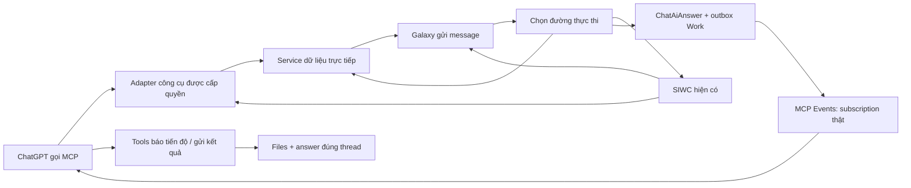

# E05 nền MCP hai chiều và điều phối AI — SPEC-F1

Ngày 2026-10-14. Chờ duyệt thiết kế cho phần khả năng mới; sửa bug trạng thái hiện có được thực hiện độc lập. Nguồn yêu cầu: ưu tiên mới của owner trong phiên hiện tại. Không mở rộng luồng báo giá/hợp đồng/marketing mới; chỉ nối nghiệp vụ đã có.

## Mục tiêu và bằng chứng nền

R14 local-821c50ee9703/schema97 đã owner activate session20261013T190755Z-d6e37571e5654a58b840a117c9ad4ba2; runtime READY. OAuth owner consent19:09:19Z/token19:09:22Z bền vững. Job chao19:12:50Z, attempt1, outbox cùng transaction; trạng thái MCP WAITING_SUBSCRIPTION, zero subscriptions/deliveries/providerStartedAt. UI ghép nhãn RUNNING chung với nhãn MCP là bug; chưa có bằng chứng Work xử lý hoặc bị inference chậm. Trace private đã lọc: .runtime/e05-foundation-20261014/initial-main-job-trace.json và initial-http-trace.json. Không lưu secret/yêu cầu khách hàng vào spec.

Thành công ưu tiên: đếm Project thật bằng cùng predicate+aggregate trong @Galaxy OS và Galaxy; chào/ý định chưa rõ không kẹt, Work thiếu đăng ký được báo ngay; một thao tác ghi đúng Project thử; sau đó event→file+memory→XLSX thật quay về đúng thread. Không suy ra live từ fixture/discovery.

## Lựa chọn kiến trúc

Chọn adapter mỏng vào domain services hiện hữu và điều phối trong Project AI hiện hữu. Tạo thêm tools vào McpServerService, giữ nguyên5tools E05; ChatAiAnswer/Files/IAM/Project memory/outbox vẫn là nguồn chuẩn. Không tạo assistant/job/queue/chat/storage thứ hai. Phương án gọi vòng MCP→SIWC→Work cho truy vấn đọc bị loại vì vừa chậm vừa tạo vòng lặp; API trả phí/Workspace Agents/automation UI ChatGPT nằm ngoài phạm vi.

### Hai đường

Đường A trả kết quả ở ChatGPT; chỉ ghi Galaxy khi user yêu cầu lưu với đích cụ thể. Tool đọc không tạo job/call inference. Đường B luôn lưu câu hỏi nguyên gốc, requested_executor/effective_executor và receipt; tóm tắt điều phối chỉ bổ sung.

## Công cụ và quyền

Bổ sung galaxy_get_workspace_context; galaxy_count_projects/list_projects/get_project/get_project_summary; galaxy_search; galaxy_list_project_records/get_record; galaxy_list_files/read_file; galaxy_get_project_memory; galaxy_list_jobs/get_job_status. Dùng ID đã tìm được hoặc tên Project; trả danh sách trùng để phân giải, không ép user nhớ UUID. Schema cụ thể, phân trang, provenance/version/timestamp và next cursor; không công cụ SQL/shell.

Scopes mới galaxy.data.read/galaxy.data.write phân biệt đọc/ghi dữ liệu nghiệp vụ với3scopes jobs/events cũ. Giữ DCR/client đang có; thêm scope cần owner consent một lần sau release/rescan, không registration lại vô cớ. Tools/list quảng bá rõ securitySchemes; access token thiếu scope nhận challenge để cấp bổ sung. Scope không tự cấp quyền nghiệp vụ.

Mỗi call xác minh OAuth/principal và IAM mới nhất; wrapper áp dụng permission tương ứng controller rồi gọi service vốn kiểm scope Project/record/file. Không tin organizationId/userId trong args. Không đưa financial field ngoài quyền. Không dùng tên Owner làm bypass. Operations cập nhật kiểm base version nguyên tử và domain workflow/approval; retry dùng operation_id/clientKey bền vững.

### Count contract

ProjectsService có sẵn aggregate count trong list. Tách predicate/filter chung ra phương thức dùng lại và thêm count chỉ query aggregate, không tải page/cả Project. Default mọi Project không deleted trong tổ chức/phạm vi được phép; status gồm PLANNING/ACTIVE/ON_HOLD/COMPLETED/CANCELLED, muốn đang triển khai dùng ACTIVE rõ ràng. Không gộp Lead/Opportunity và các góc nhìn. Source hiện không có archived riêng thì báo đúng; không tự tạo nghĩa archived. Return count, scope, normalized filters, queried_at. Pagination/list dùng chính predicate đó. Count engine ở Galaxy gọi cùng method.

### Ghi phù hợp trên domain hiện hữu

Ưu tiên tạo/cập nhật note/memory bằng clientKey+version và TasksService tạo/cập nhật/chuyển trạng thái. Idempotency bền vững bằng cơ chế đã có; khi Task chưa có receipt, dùng Activity cùng transaction với domain write, operation key+payload digest+actor scope và lock chống trùng. Không thêm bảng job mới. Phiên bản cập nhật là CAS trong domain transaction; trả conflict khi base cũ. Từng adapter draft/transition còn lại chỉ expose thao tác đã có service/schema/permission/approval và receipt kiểm được; không tự mở luồng nghiệp vụ mới. Lưu file dùng Files/uploads hiện hữu, streaming và checksum; không giữ URL tạm làm artifact.

## Điều phối Galaxy

Composer có Tự động/Galaxy AI(SIWC)/ChatGPT Work. Explicit route được tôn trọng; chưa sẵn sàng báo nguyên nhân, giữ draft/job, không silently đổi provider. Tự động chỉ nhận ý định xác định rõ qua service trực tiếp (count/list/search), dựa cả ngữ cảnh/đầu ra/file chứ không độ dài. Chào/ý định mơ hồ dùng SIWC GENERAL với context hội thoại cần thiết nếu account khả dụng, không planner nhiều bước. Nếu cần môi trường Work thì kiểm subscription, tạo job nguyên gốc+snapshot/references. Một executor làm nhiệm vụ, không nhân đôi. Tool đọc gọi từ Work đi service trực tiếp và không quay router.

Tái dùng ChatGptConnectionService đã inference thật trong E03/E04; catalog của account hiện tại, cùng token với inference, store:false/stream:true/input array và terminal event. Local function tools thi hành ở Galaxy, gửi result về model. Không mặc định hosted MCP/Code Interpreter/Work environment của SIWC. Chỉ thay routing/context ở nơi cần; không sửa source R41 dở dang ngoài phần đã được owner giao.

## Model/reasoning/tốc độ

Model và reasoning lấy catalog/capability của connection hiện tại; truyền đúng tham số, ghi requested/sent/provider-reported cùng request/terminal receipts. GENERAL fast không mặc định DEEP/max. Manual selection được giữ và báo không khả dụng ngay. Ba nhóm tách biệt: model, reasoning, service tier; không quảng bá Ultra/x1.5/tier khi chưa có contract+request accepted. Work hiện chưa có tài liệu cung cấp remote control model/reasoning: UI ghi Work quản lý, effective unknown; yêu cầu nhanh/sâu trong nội dung không là bằng chứng đổi engine.

## Context và file

Chia sẻ quyền và Context Builder/domain retrieval hiện hữu, serialize theo SIWC/Work. Count không tải file/memory; đọc tài liệu pin version/bytes. Context có source/version/time, recent dialogue/decision/rule và output criteria, artifact base version. Chia trang và đọc tiếp; ghi omissions/coverage, không tự gọi đầy đủ nếu bị cắt. Memory phân loại confirmed/unverified/decision/preference, conflict/version dựa service hiện có.

Standalone files không yêu cầu throwaway job: cấp ticket scope file/version/OAuth principal, endpoint tải kiểm lại quyền/revoke/bytes qua FilesService. Đọc text hỗ trợ bounded page/cursor, Office/PDF dùng parser hiện hữu khi cần; tải original bytes khi native Work cần. Nhận output giữ fileParams/5tools E05, text sequence/file receipts/checkpoints/finalize-required-files như r14. Không đổi đích Project/thread từ callback. NEEDS_INPUT tiếp tục cùng job/attempt và original request, không chuỗi job rời.

## Trace và UI thật

request_id/message_id/job_id/attempt/event_id nối UI→API→route→context→job/outbox→matching subscription→delivery→ACK→tool reads→progress→text/file persistence→UI. Chưa xảy ra ghi null/not observed; không timestamp giả, không log tokens/code/verifier/state/signature/signed URLs/customer content. Trace/duration nhẹ nằm metadata/logger hiện hữu; provider first output chỉ từ delta thật.

Dùng mcpJob.state cho mọi trạng thái Work; RUNNING chung không là inference. Composer báo no OAuth/no subscription/project filter/ready/error ngay, hướng dẫn Work monitor/copy prompt, action connect/retry/cancel. Waiting/subscribed/notified/processing/needs input/receiving/completed/error/cancelled tách rõ; ACK2xx chỉ nhận callback. Thời gian chờ từ timestamp thực, cảnh báo không tự hủy job. Diagnostics copy IDs, technical logs trong details. Không redesign chat. Typing chỉ draft, không gọi create job.

## Matrix và triển khai

Matrix ghi service hiện hữu, read/write permission, tool/action, schema và tests cho Project/Customer/Contact/Task/Chat/File/Memory/quotation/contracts/payment/procurement/logistics/installation/handover/warranty/marketing. Các backend/operations không có đánh dấu NOT_IMPLEMENTED hoặc NOT_EXPOSED, không fixture data giả. Controllers chứa logic sẽ được chuyển vào service để hai entrypoint dùng cùng logic, không copy.

Tạo candidate/release mới ngoài r14, hash/source/tree/artifacts/gates đúng candidate. Giữ runtime khỏe, schema97 khi không cần migration; nếu bắt buộc schema thì migration bổ sung qua prisma:migrate và SQL review, nâng guard bằng DDL thực/quy trình compatibility, không fingerprint giả/reset. Deployment script giữ authority preflight, closed gate+network/drain, unique snapshot/journal, API/Web/Edge đồng bộ và auto rollback/current DB. Sudo owner chỉ khi phiên thiếu thật. Không commit/push.

## Nghiệm thu và độ trễ

Focused RED→GREEN cho root bug, count aggregate/filters/pagination/ACL, scope/revoke/crossProject, CAS/idempotency, fast routing/no loop, input-typing/no submit, files/restart/late attempt. Full gate một lần trên candidate cuối, browser acceptance và review; chỉ rerun do thay đổi/failure liên quan.

Đo nhiều mẫu warm/cold với N/tải/error, p95 không lấy một mẫu: API accept/job và count target<1s; routing/context/DB/queue/event/first output/processing/save/UI tách riêng. Không cam kết latency OpenAI. Live owner @Galaxy count/list/name resolution/summary/files/read/write note và Galaxy count/greeting/unknown/file memory/Work XLSX/unsubscribe/revoke; native fixtures chỉ là local evidence. Nếu tài khoản/runtime thiếu subscription/consent thì ghi dependency thực và tiếp tục phần độc lập. Checkpoint/STATUS cập nhật theo bằng chứng. Không gọi kết nối hoàn tất khi mới metadata hoặc local test.
