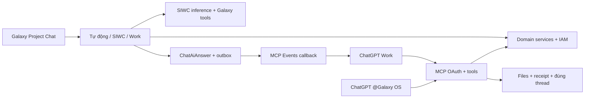

> CP-r20 2026-10-14T10:45:21.794050+00:00: storage cleanup complete inLinux, Windowsreclaim OWNER_STEP. R32 active unchanged; installed R21 aggregate10 confirmed again. Current-submission-only file follow-up corrected/local5testsPASS, not deployed. LiveWorkXLSXreceipt stillERROR; no remoteperjobmodelcontrol or full-main-chat acceptance claim. See [checkpoint](E05_MCP_WORK_CHECKPOINT.md) and [storage report](STORAGE_CLEANUP_20261014.md).

> CP-r17 2026-10-14T05:47:06.015855+00:00: diagnosed drain/FIFO correction localR32 frozen/staged/reviewed; main21 unchanged, owner sudo pending. Existing actual ChatGPT project count/search/note remain verified; generated XLSX and broader gaps remain OPEN. See handoffr3.

## CP-r12 final source correction — 2026-10-14T02:58:15.304175+00:00

New regressions verified before final candidate: edited existing confirmed note caused clarification409; financial classification then finance-read revocation still left private source readable/listed. Corrections now pass focused20 and source-proof12 tests. Clarification permits historical source-free direct notes only during refresh, retains original source-backed memory refs for older artifact authority, and keeps file/history/version/ownership/attempt checks. Changed or revoked source-backed lineage remains blocked; this is not a bypass of source rights. Shared checkSource now applies existing hiddenProjectFileIds with fresh actor and Project, including previously issued tickets. Unpromoted own attachments still work.

r24 is an unfrozen snapshot superseded before gates by these review findings. r25 is the next final candidate, baseline serving frozen21; lint/type/format/full/build/browser/restart/freeze/stage still pending. No new migration, tool names, input schema or scopes. Existing R21 plugin can continue after runtime update without registration/consent changes. Review and sudo-capability check in progress; sudo-n explicitly reports password required, so the terminal cutover remains owner-only and no serving service is stopped while waiting.

## CP-r12 continuation correction — 2026-10-14T02:46:57.413367+00:00

Owner's real Galaxy OS R21 plugin also found the trial by name and returned its actual PLANNING/stage1 summary at09:35local. Its “0 files” came from the generic Files policy intentionally excluding private Chat attachments. New adapter routes only the connected account's own private source IDs through existing ProjectAiService checkSource/downloadFile permissions, ownership, version, origin receipt and Project checks. Generic Files permissions remain intact. The independent file tool returns explicit Project-record/private-Chat pagination groups and a combined authorized total; unavailable private access returns total unknown, not a false zero. No new tool, scope, schema migration or consent is required.

Continuation had a second reproduced context bug: McpJobsService.clarify incremented attempt but retained old memory snapshot. Shared workspaceMemory now refreshes authorized confirmed notes and durable MEMORY_REVISION proofs within the same clarification transaction. Original request, thread, input pins and previous receipts remain. memory_snapshot_at identifies the updated part. RED expected new note/got[]; GREEN3. Private file RED expectedcount1/got0; owner text bytes/download/wrongversion/nonowner tests GREEN5 including ordinary file/memory/clarification. Pagination aggregate/visibility extension check in progress.

r23 source review Ship/lint/type/format PASS are retained with their exact scope; its full test was deliberately interrupted before freeze to include these two newly proven issues. r23 is not a complete gate result or deployment target. Candidate r24 will contain the full correction; main r21 remains serving/schema98. No applied migration edited or production data restored.

# E05 SPEC-F1 — capability thực có trong candidate

Nguồn: source branch `m2/project-chat-20260928`, HEAD `dd66c64046bcfcd5a40bdbf4bfa8df15d80ff04e`; candidate r21 `local-f5576eb2bd2d`. R21 đã phục vụ23tools public; owner đã nghiệm thu count10, tìm/tóm tắt Project và ghi chú riêng qua plugin Galaxy OS R21. Bản sửa memory/private Chat files mới vẫn source-only, chưa phục vụ. Cập nhật 2026-10-14T00:05:01.885772+00:00.

| Phân hệ                  | Service tái sử dụng                         | Quyền đọc                                                                                                          | Tool/record type                                                    | Ghi qua MCP hiện có                                                                                          |
| ------------------------ | ------------------------------------------- | ------------------------------------------------------------------------------------------------------------------ | ------------------------------------------------------------------- | ------------------------------------------------------------------------------------------------------------ |
| Project                  | ProjectsService                             | project.read theo phạm vi từng assignment                                                                          | count/list/get/summary; aggregate không phụ thuộc page              | Chưa expose tạo/sửa Project                                                                                  |
| Khách hàng/đầu mối       | CustomersService + SearchService            | crm.customer.read / crm.contact.read và Project                                                                    | customer / contact; search                                          | Chưa expose                                                                                                  |
| Lead/Opportunity         | SearchService                               | crm.lead.read / crm.opportunity.read                                                                               | search (không tính là Project)                                      | Chưa expose                                                                                                  |
| Task                     | TasksService + Activity                     | task.read theo visibility và Project                                                                               | task; search                                                        | create/update task mở, operation UUID ổn định, expected_version; không sửa ngân sách/duyệt/đánh dấu hoàn tất |
| Chat AI                  | ProjectAiService/ChatAiAnswer               | ai.invoke + grant + own thread                                                                                     | ai_thread; job/context                                              | job result/progress/clarification đúng thread; chưa expose chat room thường                                  |
| Files                    | FilesService/FileStorage + source index     | file.read + file.download, version/quyền sống                                                                      | list_files/read_file; job input original bytes                      | File kết quả qua submit_job_result; chưa expose upload độc lập vào hồ sơ                                     |
| Bộ nhớ                   | ProjectAiMemoryService qua ProjectAiService | grant và memory scope                                                                                              | get_project_memory                                                  | save/update_project_note: UUID đích, operation/version, nguồn rõ                                             |
| Dự toán/báo giá          | CommercialService                           | estimate.read / quotation.read                                                                                     | estimate / quotation                                                | Chưa expose draft/transition                                                                                 |
| Hợp đồng                 | ContractsService                            | contract.read                                                                                                      | contract                                                            | Chưa expose draft/transition                                                                                 |
| Thu tiền                 | ContractsService                            | receivable.read                                                                                                    | receivable                                                          | Chưa expose                                                                                                  |
| Mua hàng                 | ProcurementService                          | purchase_request.read / procurement.rfq.read / procurement.proforma_invoice.read / procurement.purchase_order.read | purchase_request / rfq / proforma_invoice / purchase_order          | Chưa expose                                                                                                  |
| Công nợ/chi nhà cung cấp | ProcurementService                          | supplier_payable.read / supplier_payment.read                                                                      | supplier_payable / supplier_payment                                 | Chưa expose; bank_information.read còn kiểm tra theo Project, che tham chiếu ngân hàng nếu thiếu quyền       |
| Logistics                | LogisticsService                            | logistics.shipment.read                                                                                            | shipment                                                            | Chưa expose                                                                                                  |
| Sản xuất                 | ProductionService                           | production.read                                                                                                    | production_order                                                    | Chưa expose                                                                                                  |
| Thi công                 | InstallationService                         | installation.read                                                                                                  | installation_plan                                                   | Chưa expose; getter hiện trả bản kế hoạch/danh sách, chưa toàn bộ chi tiết đội                               |
| Nghiệm thu/bàn giao      | AfterSalesService                           | inspection.read / handover.read                                                                                    | inspection / handover                                               | Chưa expose                                                                                                  |
| Bảo hành                 | AfterSalesService                           | warranty.read                                                                                                      | warranty_asset                                                      | Chưa expose                                                                                                  |
| Marketing                | MarketingService                            | marketing.campaign.read / marketing.content.read, scope owner/author                                               | workspace campaign / marketing_content (không giả liên kết Project) | Chưa expose; không bật controller generation/publication đang gated                                          |

Tất cả adapter dùng domain services hiện có, không có SQL/shell tool. List/get kiểm tra danh tính OAuth thực, Organization và quyền Project. Project đọc theo tên/code: exact rồi tìm có phân trang; ID từ tool được dùng cho thao tác ghi. Record UUID không được thay Project đích. Domain records tài chính vẫn chịu quyền cụ thể và trạng thái phê duyệt của domain.

## Tools và scopes

Job tools giữ tên/schema chính E05, scopes `galaxy.jobs.read`, `galaxy.jobs.write`, `galaxy.events`. Business read cần `galaxy.data.read`; note/task write cần thêm `galaxy.data.write`. Consent cũ không tự được nâng quyền. Tool có annotations/securitySchemes và input JSONSchema theo `io: input`; output envelope có schema, phần domain record theo quyền không giả bộ trả mọi trường.

- `galaxy_get_job`
- `galaxy_get_job_context`
- `galaxy_get_input_file`
- `galaxy_report_job_progress`
- `galaxy_submit_job_result`
- `galaxy_list_workspace_records`
- `galaxy_get_workspace_record`
- `galaxy_get_workspace_context`
- `galaxy_count_projects`
- `galaxy_list_projects`
- `galaxy_get_project`
- `galaxy_get_project_summary`
- `galaxy_list_files`
- `galaxy_read_file`
- `galaxy_get_project_memory`
- `galaxy_save_project_note`
- `galaxy_update_project_note`
- `galaxy_list_jobs`
- `galaxy_create_task`
- `galaxy_update_task`
- `galaxy_list_project_records`
- `galaxy_get_record`
- `galaxy_search`

## Hai đường và giới hạn đã xác định

AUTO hiện có đường trực tiếp cho câu đếm Project xác định; câu chào/một ký tự không gắn context dùng SIWC tối thiểu; file/đầu ra Work được giao qua Events. List/search/get trực tiếp bằng MCP hoạt động không cần job; AUTO list/search/get tổng workspace còn cần mở rộng sau vòng sử dụng đầu tiên. Lựa chọn SIWC/Work rõ ràng được giữ, không silently fallback. Work chưa subscribe phải hiện nguyên nhân chờ; ACK không phải PROCESSING.

UTF8 text pages dùng `text_offset` là UTF8_BYTES: bắt đầu0 rồi dùng `next_offset`, stream seek đúng byte cursor, nội dung/phiên bản nguồn được ghim. XLSX/DOCX/PDF/ảnh/video dùng original protected download; không coi filename là nội dung đã đọc. File đầu ra phải có native download_url/file_id và bytes được Galaxy lưu trước finalize. Artifact attempt trước không chứng minh attempt sau hoàn tất.

SIWC model lấy từ catalog tài khoản; requested/sent/observed model/effort có receipt. First output là TEXT_DELTA hoặc TERMINAL_TEXT; không dùng reasoning nội bộ. Work model/reasoning do Work quản lý khi chưa có contract điều khiển được xác nhận. Service tier chưa được hỗ trợ: không hiển thị như đã đổi tốc độ engine.

## Nghiệm thu còn cần bên ngoài

Sau candidate gates/browser/build và activation: owner refresh discovery/consent thêm data scopes rồi hỏi count/list/find/files/read/write trong ChatGPT thật. Cùng câu count trong Galaxy phải đối chiếu cùng definition. Kết nối OAuth/Events văn bản r14 đã có bằng chứng thật; 23 tool mới và XLSX ChatGPT tạo chưa nghiệm thu public. Không dùng fixture để thay bằng chứng này.
