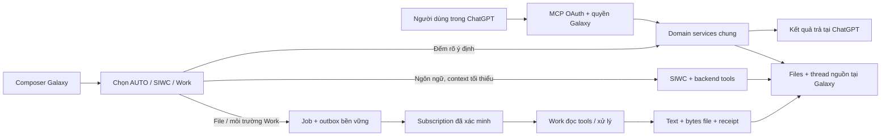

## E05 CP-r18 in progress — R32_ACTIVE_PUBLIC / SIWC_FIFO_LIVE_FIXED / REAL_XLSX_DECODER_CORRECTION — 2026-10-14T07:07:07.371976+00:00

Owner activation session `20261014T062023Z-ac11d3b78efe483f98775d1f8ac33602` is ACTIVE_PUBLIC_VERIFIED. Actual API83588/Web83590 R32 `local-d2565a503380` READY/schema98; six public HTTPS JSON/401/400 contracts verified06:24:02Z with API/Edge release headers. Main business smoke06:25:27Z count10 via shared aggregate, private note replay/readback once, private input6493B/SHA verified through real HTTPS. Original blocked SIWC job d9bae121-ed5b-49df-aded-3aae5a1614d4 completed06:21:20Z, one real provider round, gpt-6.1-sol/high requested/sent/provider-reported, terminal response.completed. Provider15.956s/first text12.001s, processing17.839s; one high-effort sample, no p95/fast-greeting claim. Supersedes CP-r17 R32-not-active state.

Same genuine Work trial821fee96-5d1a-4fd5-b985-2f9157cf1427 continued with confirmed memory atattempt2. Event3d47d9de delivered06:26:50Z; actual processing06:28:39Z/text and native XLSX reference06:31:36Z received. Old connected plugin actual read tools onR32 read context3355characters/nextOffsetnull with confirmed source6032b836.../version1. Work-generated XLSX import fails WORKBOOK_READ_UNAVAILABLE inside bwrap; real network200/4653B proves file transfer schema works, not storage completion. Job remainsERROR. Retry samejobattempt3 generated eventf1aa17eb delivered06:48:48Z; file reference refreshed, no new job/thread.

Actual generated4653B archived privately for diagnosis, SHA6398cb36a77ca818fcddcce12439a529034b02bdc13c431d9de59af524e104db. It has package-rooted worksheet Target=/xl/worksheets/sheet1.xml permitted by OPC. Old Python decoder rejects this legitimate path; regression RED1FAIL11PASS. Minimal source normalization for single leading slash with// rejection retains xl-prefix/ZIPmembership/Internal/XXE/sandbox guards. Source tests39PASS, actualWork file13-case suitePASS, raw cells/formulas D9:D13 independently inspect600000/60000/540000/43200/583200. G00 full ingestion/download/replay of exact same bytesPASS (OAuth+newcase2). This is not live Galaxy Files receipt: R32 stillfails; newcandidate33/build/gates/stage/activation required. ExcelJS4.4 also cannot open this representation, no ExcelJS PASS claim; native decoder and OOXML checks used.

No frozen R32 mutation, DB migration/reset/restore, Git publication or paid provider. Work subscription remains on old Galaxy Os app and is valid; Galaxy OS R21 client has addeddata scopes but same endpoint. Keep old subscription until deliberate migration after artifact acceptance; do not remove the app mid-recovery. Owner no longer needs to handle UUID/file-reference details; retry was triggered through existing Galaxy domain workflow. Original request/files/Project/thread preserved. Broader foundation matrix gaps remainOPEN.

## E05 CP-r17 — R32_FROZEN_STAGED_REVIEWED / R30_FAILED_ROLLED_BACK / R21_ACTIVE / OWNER_SUDO_REQUIRED — 2026-10-14T05:47:06.015855+00:00

Owner R30 activation failed `DRAIN_PENDING_WORK_ABORTED_CUTOVER`; session `20261014T044102Z-f76d1582a9084721af7740d5be4c3ab9` safely rolled back before switch_apps and retained current DB. Do not retry R30; R31 was also superseded before deployment after fixing a missing Prisma test mock. R21 `local-f5576eb2bd2d` remains READY/schema98, API18213/Web18215 verified again after preparation. No DB restore/reset, job cancellation or Git publication.

Diagnosed exact blocker: native SIWC job `d9bae121-ed5b-49df-aded-3aae5a1614d4` remains never-claimed QUEUED and is held by an earlier genuine same-thread MCP RUNNING/NOTIFIED job. Old drain counted the durable queue as running, and old native FIFO mixed Work notifications with native executions. Fix: native process counter before claim awaits; stop polling on drain; parameterized null-safe native FIFO excludes MCP; queued work exemption requires observed process counter or the much narrower genuine earlier NOTIFIED blocker on legacy R21. Actual read-only main census repeated3 samples oldactive1/newactive0/waiting1, no admission fence or cutover claimed. Active/leased/provider-started/malformed/unsafe-state jobs remain blocked.

Frozen R32 `local-d2565a503380` sourceSHA `d2565a5033807f3b241b4de4751617f844a71ea9d4a19af41b104391b8db9cf1`, packetSHA `7272f939145d5f28234ea55adcbce1fd8685af77144f65d0794c26a350ce82df`, metadataSHA `e071549124e5fa7180115a3ddf276cfce88978a016a30101435dd60e5dd962f1`, testedTree `8c5ea25dc418d137214dc0ab8b6a7e3238c3b88a`, actualWebBUILD_ID `39v0wBQAI45EDZpcK15W1`. Stage planSHA `4737467ca6cb5b4fc9b7ad61bf0e03caa674f3f85fa7b71b0138f74e391267da`; from active21/schema98,8hashes/4artifacts, MCP key preserved. Source/preparation and final frozen/stage Ponytail/correctness/security/authorization review SHIP_FOR_OWNER_ACTIVATION. Stage/main98 and isolated unit checks PASS; live D-Bus/private socket inodes unchanged.

Regression scope2692PASS+1SKIP is COMPOSITE with actual-byte source equivalence: R31 full112 unaffected API files plus Web643/Edge9; only its one-worker provider fixture missed `$queryRaw` and caused38 failures. Added mock without changing assertions; exactR32 provider115/doc1 PASS, dedupAPI2001−77+115=2039. Original sandbox/full exit1 receipts remain SHA-bound, not reported as a fresh full successful invocation. R32 lint/type/format/build/deployment17/browser1/nativekill-restart-checkpoint-duplicate1 PASS; exact artifact digests before/after equal. No production change between31/32; only test fixture and2 historical status files.

LOCAL_CODE_VERIFIED: PASS boundedR32. RUNTIME_ACTIVE: R21, R32 NOT_ACTIVE. PUBLIC_MCP_VERIFIED/OAUTH_LIVE_VERIFIED/CHATGPT_TOOLS_VERIFIED/EVENTS_LIVE_VERIFIED: existing R21 evidence retained with original scope; R32 NOT_RUN. ARTIFACT_LIVE_VERIFIED: NOT_VERIFIED, genuine same Work XLSX job still NEEDS_INPUT/no generated artifact. Existing Galaxy OS R21 five-scope plugin remains usable; no new scopes/schema or reinstall required for this correction. Full matrix/AUTO and business-draft gaps remain OPEN.

sudo-n requires owner terminal password; no service stopped while waiting. Run the exact activation command in [handoffr3](/home/galaxy_os/prompt/E05_FOUNDATION_HANDOFF_r3.md). After owner activation: verify actual release/public six contracts and business smoke, then clarify/resume SAME Work trial to include confirmed Project memory, receive actual XLSX and check583200; never infer completion from callback ACK. Post-publicv2 downgrade to older receiver is blocked even with zero pending jobs; retainDB and recover forward compatibly. Supersedes CP-r16 and R30/R31 activation instructions.

## E05 CP-r16 in progress — R30_DRAIN_ABORTED_ROLLED_BACK / R31_CORRECTION / R21_ACTIVE — 2026-10-14T05:11:58.352758+00:00

Owner R30 activation journal `20261014T044102Z-f76d1582a9084721af7740d5be4c3ab9` ended `ROLLED_BACK_CURRENT_DATABASE_RETAINED` before switch_apps. API/Web/Edge remain R21 and schema98; no DB restore. Supersedes CP-r15's pending R30 activation instruction: do not retry R30.

Root cause: native SIWC job `d9bae121-ed5b-49df-aded-3aae5a1614d4` is durable QUEUED with no lease/provider start/attempt. R30 census counted it active. Legacy native FIFO also includes an earlier MCP job in RUNNING/NOTIFIED, so native dispatch waits although Work has not started. No DB locks or live provider execution observed. Fix retains genuinely active/uncertain work guards: process-native counter begins before claim awaits; polling stops during drain; parameterized native FIFO excludes MCP; legacy queue exemption only for earlier same-owner/org/thread genuine NOTIFIED blocker. No cancellation, job mutation, auth bypass or migration.

Meaningful RED retained; focused PostgreSQL FIFO/drain tests3PASS (including NOTIFIED positive and unsafe-state/principal/order negatives), admission5PASS and deploy17PASS; source typecheck PASS. Exact R31 snapshot `local-a2cd1749f736`, sourceSHA `a2cd1749f736abce304611a72b47735ecd3be1a9f969971313daedd1d4206145`, packetSHA `432d1300fdf5e8002cd16cd0ce7bbe8e8dba7e43548b5fa96f142b7efe13795e`. Fresh candidate lint/type PASS; remaining full gates/build/browser/recovery/freeze/stage review in progress. R31 is NOT_ACTIVE, not public-verified. R30 frozen bytes retained unchanged.

Genuine ChatGPT plugin count/name/summary/note and previous Events/text evidence remain scoped to serving R21. Same Work XLSX trial remains NEEDS_INPUT/no artifact; resume only after corrected runtime activation/public proof. No Git publication or unrelated feature expansion.

## E05 CP-r15 — R30_LOCAL_FROZEN_STAGED / R21_ACTIVE / OWNER_SUDO_REQUIRED — 2026-10-14T04:37:14.825290+00:00

R30 `local-bbdaede6be81`, sourceSHA bbdaede6be8193725e74209c8330fd98ad99b4b8c234697629f3335c2bc4114b, packetSHA ec38a7d60c085bf1c6f1c48252218482bd59e99850178487c877d2bfad86e23e, metadataSHA46d2dda586547ba1a655289f31d9fc448f771ba5da379b95e3fd600e6783caa2, planSHA01c7b3a7dc10354db4241059f28f58149b53c7f6e3e80da2c8b5a606d20e4916. Main R21 READY/schema98; no deployment/DB restore/commit/push. Owner plugin count10, Project name/summary and exactPRIVATE/UNVERIFIED note verified; generated XLSX still NEEDS_INPUT, no artifact receipt.

Local coverage2687PASS+1SKIP is COMPOSITE_REGRESSION_VERIFIED: original full2033APIpass+sole5s timeout/112otherfilesPASS, full MCP41 on unchangedcandidate rerunPASS3236ms/default5s, Web643/Edge9 and separate document1. Original pnpmtest exit1 retained, unknown timeout cause; no timeout raised or assertion weakened. Lint/type/format/build PASS; deployment16/browser1/nativekill-restart-checkpoint-duplicate1 PASS; artifact digests before/after exact. Reviewsource/preparationSHIP; stage/main98check and isolatedunitsPASS04:35:54Z, livecontrolplane inodesunchanged. Final frozenstage review SHIP_FOR_OWNER_ACTIVATION; terminal owner pending.

Correction includes confirmed memory paging/sharedSIWCWorkcontext, samejobclarifyrefresh/attempts, ownedprivate Chat files throughfreshsource/version/finance checks, authoritymemo/nativeancestry/trustedDBflattenedsummaryguards, and post-publicv2 downgradeblockevenzero pendingstates. No scope/tool-input/name/migration changes. Existing Galaxy OS R21 plugin remainsusable afterupdate; new consent notneeded.

sudo-n reports passwordrequired; Edge/nft cutover needs ownerterminal, no service stoppedwaitingpassword. Postactivation public6contracts/businesssmoke/samejobresume helpers prepared and bound to exactR30, notexecuted. See [handoffr2](/home/galaxy_os/prompt/E05_FOUNDATION_HANDOFF_r2.md). Full scope/businessdraftwrites/AUTOlistsearchget/livefile/workcontrol gaps remain in capabilitymatrix; no globalcompletion claim.

## E05 CP-r14 in progress — 2026-10-14T03:59:46.699564+00:00

Serving runtime remains frozen21 `local-f5576eb2bd2d`, API/Web READY, main schema98; no cutover or DB restore. Owner's actual Galaxy OS R21 plugin count10/name lookup/summary and note write verified; note readback receipt at03:04:31.753Z is PRIVATE/UNVERIFIED/version1 in the trial Project, exact content saved once. Latest real Work trace03:55:30.514Z remains same job/attempt1 NEEDS_INPUT, actual input6493B read, event DELIVERED, no generated artifact.

Context correction is SOURCE ONLY: confirmed accessible memory paged in full, clarification refreshes same job memory, independent owned Chat files use current source/version/financial checks, and mcp-data-v2 blocks post-public downgrade to older receivers even with zero pending state. Failed/superseded candidates22–28 are not deployment targets. Full26 FAIL27 is retained, not converted to PASS.

Fresh source proof16unit PASS; serial PostgreSQL targeted33PASS/2FAIL/143SKIP. Native24 consecutive turns PASS108.305s; all selected MCP/context/privatefile/clarification/discovery and memory ACL cases passed. Remaining: flattened summary ancestry falsely rejected on saved-note read; tool-rollback fixture expectation now checks only the uncommitted target revision, retaining existing confirmed context. Native cached-ancestry fix and summary authority contract are under independent review. New29 runners prepared, candidate not yet created. Full regression/browser/recovery/freeze/stage/cutover and live XLSX remain required. No new scopes, input schemas, tool names, migration, commit or push.

## E05-CP-r13 — live count, lookup and note write verified; final regression correction

2026-10-14T03:21:52.508426+00:00. Main remains r21 local-f5576eb2bd2d/schema98 READY. Owner's new Galaxy OS R21 plugin has five real granted scopes, counted10 Projects, found the trial by name and read actual PLANNING/stage1 data. Owner then saved the exact requested note; backend readback at03:04:31.753Z confirms one record `afacf13c-8322-4bca-84a1-30bfa628bef3`, revision1, PRIVATE/UNVERIFIED, correct trial Project. This is an actual plugin write plus persistence proof, not a fixture/business decision.

R27 source/security/preparation review Ship; fresh lint/type/format/build/deployment16 PASS. Only two Python deploy files differ from r26; exact973-input proof was prepared to avoid replaying application tests. Full r26 application test is not PASS: source-discovery case expected no sources but new confirmed memory context legitimately produces a MEMORY source. Corrected assertion now permits MEMORY while still forbidding discovered-only FILE citations; no product or permission relaxation. R28 will carry this focused test correction and fresh final verification. Unfinished/failed candidate gate logs remain; none is an activation target before complete freeze/stage review.

Receiver revision mcp-data-v2 (wire MCP2026-07-28 unchanged) identifies widened memory-root and private source-ID file transport. Post-public downgrade to older receiver always fails closed, even completed jobs/grants expired; before-public failed cutover can restore original21 while admissions remain closed. New RED rollback test demonstrated old guard failure at statecount0; deployment16 GREEN. Never erase state or restore DB to pass downgrade. Main sudo-n requires owner terminal password; no serving stop while preparing.

Genuine Work job821fee96-5d1a-4fd5-b985-2f9157cf1427 still NEEDS_INPUT on original21 because its context omitted confirmed price rules. Work read the6493-byte input XLSX through actual Events/tools; generated XLSX is not saved yet. Guarded same-job continuation and idempotency observer prepared for the final receiver, not executed early. After cutover, rebuild authorized memory via existing clarification, retain original file/question/thread and old source-backed artifact lineage, then verify real XLSX583200VND. Standalone private file count0 on21 is the reproduced gap now fixed in candidate; public proof of correction still pending.

## CP-r12 final source correction — 2026-10-14T02:58:15.304175+00:00

New regressions verified before final candidate: edited existing confirmed note caused clarification409; financial classification then finance-read revocation still left private source readable/listed. Corrections now pass focused20 and source-proof12 tests. Clarification permits historical source-free direct notes only during refresh, retains original source-backed memory refs for older artifact authority, and keeps file/history/version/ownership/attempt checks. Changed or revoked source-backed lineage remains blocked; this is not a bypass of source rights. Shared checkSource now applies existing hiddenProjectFileIds with fresh actor and Project, including previously issued tickets. Unpromoted own attachments still work.

r24 is an unfrozen snapshot superseded before gates by these review findings. r25 is the next final candidate, baseline serving frozen21; lint/type/format/full/build/browser/restart/freeze/stage still pending. No new migration, tool names, input schema or scopes. Existing R21 plugin can continue after runtime update without registration/consent changes. Review and sudo-capability check in progress; sudo-n explicitly reports password required, so the terminal cutover remains owner-only and no serving service is stopped while waiting.

## CP-r12 continuation correction — 2026-10-14T02:46:57.413367+00:00

Owner's real Galaxy OS R21 plugin also found the trial by name and returned its actual PLANNING/stage1 summary at09:35local. Its “0 files” came from the generic Files policy intentionally excluding private Chat attachments. New adapter routes only the connected account's own private source IDs through existing ProjectAiService checkSource/downloadFile permissions, ownership, version, origin receipt and Project checks. Generic Files permissions remain intact. The independent file tool returns explicit Project-record/private-Chat pagination groups and a combined authorized total; unavailable private access returns total unknown, not a false zero. No new tool, scope, schema migration or consent is required.

Continuation had a second reproduced context bug: McpJobsService.clarify incremented attempt but retained old memory snapshot. Shared workspaceMemory now refreshes authorized confirmed notes and durable MEMORY_REVISION proofs within the same clarification transaction. Original request, thread, input pins and previous receipts remain. memory_snapshot_at identifies the updated part. RED expected new note/got[]; GREEN3. Private file RED expectedcount1/got0; owner text bytes/download/wrongversion/nonowner tests GREEN5 including ordinary file/memory/clarification. Pagination aggregate/visibility extension check in progress.

r23 source review Ship/lint/type/format PASS are retained with their exact scope; its full test was deliberately interrupted before freeze to include these two newly proven issues. r23 is not a complete gate result or deployment target. Candidate r24 will contain the full correction; main r21 remains serving/schema98. No applied migration edited or production data restored.

## E05-CP-r12 — R21 active, direct Project count live; memory correction in progress

Updated 2026-10-14T02:31:24.035638+00:00. Supersedes CP-r11 activation state. Serving r21 `local-f5576eb2bd2d`, source SHA256 `f5576eb2bd2d93422053a1784211466c6e29a3b601d5456c00672195343ce207`, main schema98. Owner activation session `20261014T013649Z-6c2b495bf94345bfb4aeaf3b8197c05b` records ACTIVE_PUBLIC_VERIFIED; API/Web READY and six public MCP/OAuth contracts passed at01:41:03Z. No database restore or further migration.

Actual new Galaxy OS R21 authorization at02:10:09.073Z has all five scopes. Owner reports the new plugin answered “10 dự án”, matching the same Galaxy aggregate (includes the explicit E05 trial Project). This verifies the count query in ChatGPT; remaining direct read/write acceptance is open. The old Work monitor remains an active verified subscription for core job tools.

Genuine Work trial job `821fee96-5d1a-4fd5-b985-2f9157cf1427`, Project `f758dec5-3cd7-485d-b827-a8c563dd70cd`, thread `1e179d35-d5e8-414e-9e30-24e5030ec79a`: existing domain services submitted the original request/file at01:58:44.450Z (not browser submission), real event delivered01:58:47.180Z, provider processing02:00:05.191Z, NEEDS_INPUT02:00:34.422Z. Work downloaded/read the actual6493-byte XLSX and reported its row values. Context pages returned no memories despite a current authorized USER_CONFIRMED decision. No generated XLSX saved; ARTIFACT_LIVE_VERIFIED is not PASS.

Root cause: both Work and SIWC selected memory by AND-searching the first200 characters of the entire request. A paraphrased requirement excluded the saved pricing decision. Correction uses the existing authorized/versioned memory listing with pagination to include all current confirmed notes plus relevant search hits; explicit search behavior stays intact. Review exposed two further coverage bugs: the128-node graph guard counted independent roots, and SIWC assembly silently omitted confirmed notes over its context budget. New RED regressions reproduce both; corrected focused29 tests PASS, MCP context regression and candidate gates in progress. Oversized SIWC confirmed memory now fails clearly instead of inferring with missing rules.

Candidate r22 rejected before freeze: strict typecheck found an invalid unavailable-memory test field; reviewer found the two bounds/coverage issues. It is not a deployment target. Corrected candidate r23 is being prepared from frozen r21 with new identity/checksums, no migration. R21 remains healthy while testing. After public correction, resume the same trial job via the existing clarification flow/new attempt; preserve original request and receipts.

Evidence: private `postdeploy-identity-r21.json`, `public-r21-live/`, `live-trial-created-r21.json`, `live-trial-status-r21-*.json`, `memory-bounds-r23-red.log`, `memory-context-r23-green.log` under `.runtime/e05-foundation-20261014`; owner count reply in this session. Sensitive callback/download/token/code values excluded. No Git commit/push, production rule change or SIWC replacement.

# E05 SPEC-F1 — trace và nguyên nhân chờ

Nguồn kiểm chứng: main r14, candidate r21 `local-f5576eb2bd2d`, private receipts dưới `.runtime/e05-foundation-20261014`. Ngày 14/10/2026; giờ bảng bên dưới là UTC. Không lưu token, callback secret hoặc URL có chữ ký trong tài liệu.

## Lần “chao” thật trên r14

Job `8b25c39f-5f90-445f-b32d-7442b5350a8c`, request `1af1258f-4dad-4a55-a157-762f4914ec8d`, event `b62ad926-f781-46d3-9ef6-0bdd8d896102`, attempt1. Project/thread lấy từ job lưu trên server; tool thật đã đọc lại đúng job và câu trả lời.

| Mốc                                               | Bằng chứng/thời điểm                                                      |
| ------------------------------------------------- | ------------------------------------------------------------------------- |
| API lưu yêu cầu/job/outbox                        | 2026-10-13T19:12:50.754Z                                                  |
| Subscription đủ điều kiện trước khi owner đăng ký | Chưa xảy ra; probe19:39:40Z không có subscription/delivery                |
| Provider bắt đầu xử lý trong thời gian đó         | Chưa có bằng chứng; providerStartedAt null                                |
| Owner thực sự đăng ký Work monitoring             | 19:52:11.839Z                                                             |
| Callback ACK                                      | 19:52:16.652Z; xác nhận nhận event, không xác nhận xử lý                  |
| Kết quả lưu hoàn tất                              | 19:53:41.279Z; một phần text, không artifact                              |
| Đọc lại qua plugin thật                           | 2026-10-14T01:14:05.482Z; COMPLETED, đúng Project/thread, text còn nguyên |

Nguyên nhân chờ là **không có subscription khi tạo job**. OAuth/discovery có sẵn không chứng minh đã đăng ký nhận việc. UI r14 còn dùng nhãn chung RUNNING nên đồng thời hiện chờ kết nối và đang xử lý. Không có bằng chứng đây là thời gian suy luận, planner, SIWC refresh hoặc model chậm. Không tăng timeout để che nguyên nhân.

Sửa ở candidate: trạng thái MCP chi tiết quyết định thông báo, ACK không chuyển PROCESSING; chỉ báo đang xử lý khi nhận progress thật. Composer hiển thị thiếu subscription và hành động kết nối/đăng ký; job được giữ để tiếp tục. Typing không tạo job. Trace mới lưu request/message/job/attempt/event và các mốc thực, không dựng mốc chưa xảy ra.

## Hai đường thực thi

MCP đọc dữ liệu không gọi SIWC hoặc tạo Work job. AUTO hiện có đường trực tiếp cho count; AUTO workspace list/search/get còn mở. Chọn rõ SIWC/Work được giữ nguyên, lỗi readiness không âm thầm đổi provider.

## Phạm vi bằng chứng sau sửa

| Bài thử                  | Bằng chứng                                                                         | Giới hạn                                                        |
| ------------------------ | ---------------------------------------------------------------------------------- | --------------------------------------------------------------- |
| Chỉ gõ chào/x            | Browser r21 PASS: số ChatAiAnswer không đổi                                        | Local G00                                                       |
| AUTO đếm Project         | Browser POST201, kết quả khớp Prisma aggregate và MCP, reload giữ kết quả          | Local G00, chưa @plugin mới                                     |
| AUTO/SIWC chào           | Integration: một inference request, không tải Project/planner                      | Fixture provider; SIWC live được đo riêng                       |
| Chào/x SIWC thật         | Terminal event và thời gian first output thực                                      | Service probe, chưa UI main mới                                 |
| SIWC đếm thật            | Tool count_projects chạy một lần, trả9, không tạo Work job                         | Tài khoản hiện tại tại thời điểm probe; dữ liệu có thể thay đổi |
| Yêu cầu có file / memory | Tools/job/context/attempt/file failure regressions                                 | XLSX từ Work thật chưa chạy                                     |
| Restart sau checkpoint   | SIGKILL API, khởi động compiled r21, giữ text/checkpoint; duplicate không nhân đôi | Local synthetic, không ChatGPT                                  |

Cấu hình đã chứng minh: SIWC model `gpt-6.1-sol` và reasoning `low` được gửi và provider báo đúng; catalog theo tài khoản. Work model/reasoning vẫn do ChatGPT quản lý, effective unknown. Không có service tier/Ultra giả trên UI.

Số đo SIWC: chào first output2986ms/terminal3403ms; x2493/2783ms, mỗi loại một mẫu; không gọi p95. Count service/DB: cold3.619ms, warm N50/concurrency1, nearest-rank p95 1.592ms. Đây không phải HTTP/UI hoặc SLA của OpenAI. HTTP r21 tại01:28:32Z đã có receipt: G00 một Project được phép xem, concurrency1,51calls mỗi route/50warm nearest-rank p95 MCP count80.304ms và AUTO count70.647ms; loopback, không đo UI/provider.
